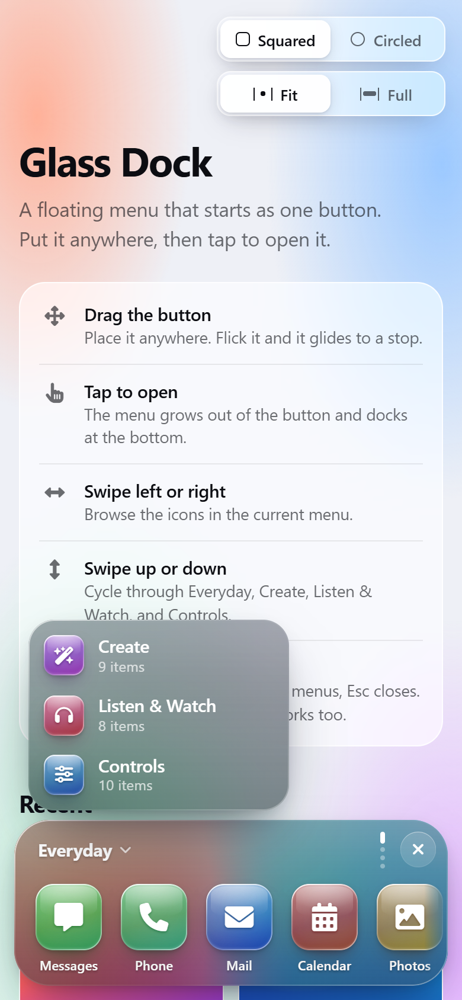
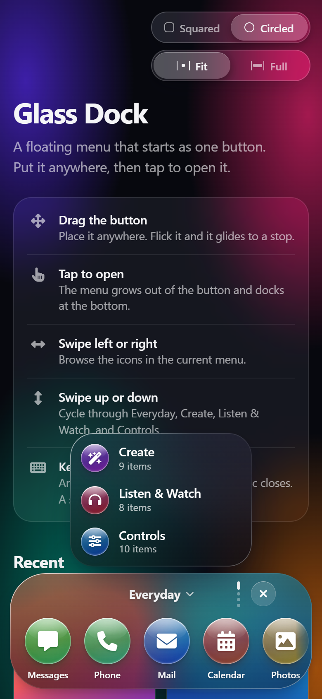

# Glass Dock — bottom menu scroller

A floating, frosted-glass menu for phones and narrow screens. It starts as a single button you can drag anywhere. Tap it and it grows into a menu bar docked at the bottom of the screen. Swipe left and right to browse icons, and swipe up and down to switch between menus.

Plain HTML, CSS and JavaScript. No build step, no framework.

[](LICENSE)

<p align="center">
  
  &nbsp;&nbsp;
  
</p>

## Features

- **Draggable button.** It follows your finger 1:1. Flick it and it glides with momentum, then settles on screen. Its position is remembered between visits.
- **Morphing bar.** The button grows into the bar and shrinks back to wherever you left it.
- **Horizontal swipe** through a menu's icons, with momentum, soft rubber-band edges and snapping.
- **Vertical swipe** cycles endlessly through menus. The title and page dots track your finger.
- **Menu switcher.** Tap the title to jump straight to another menu.
- **Squared / Circled** toggle. Icons, button, bar, toggles and pop-ups all follow the chosen shape.
- **Fit / Full** toggle. The open bar can span the screen width while keeping its edge margins.
- **Frosted glass** throughout: translucent materials, rim lighting and tinted glass icons.
- **Interruptible motion.** Every animation is a spring, so you can grab anything mid-flight.
- **Accessible.** Full keyboard support (arrow keys, Enter, Esc) and screen-reader labels. It respects reduced motion, reduced transparency and increased contrast settings.
- **Light and dark mode** follow the system setting.

## Getting started

Clone the repo and open `index.html` in a browser. No server or install is needed.

```sh
git clone https://github.com/Kevin-Herr/bottom-menu-scroller.git
cd bottom-menu-scroller
# then open index.html
```

An internet connection is needed the first time, because Motion and Font Awesome load from public CDNs.

## Controls

| Action | Touch / mouse | Keyboard |
| --- | --- | --- |
| Move the button | Drag it (flick to throw) | — |
| Open the menu | Tap the button | Enter / Space |
| Browse icons | Swipe left / right, or scroll sideways | ← / → |
| Switch menus | Swipe up / down, or scroll | ↑ / ↓ |
| Pick a menu | Tap the title | Enter on the title |
| Close | ✕, tap outside, or Esc | Esc |

## Customizing

- **Menus and icons:** edit the `MENUS` array at the top of [`main.js`](main.js). Each item takes a `label`, a Font Awesome `icon` class and a `hue` (0–360) for its glass tint. Each menu's `glyph` sets the icon shown in the menu switcher.
- **Glass and colors:** the design tokens are CSS custom properties at the top of [`styles.css`](styles.css). The glass icon recipe is in `.glass-icon`.
- **Sizes:** geometry constants such as bar height, icon size and margins are near the top of `main.js`. Keep them in sync with the matching CSS values noted in comments.

## Built with

- [Motion](https://motion.dev) (MIT): spring animation.
- [Font Awesome Free](https://fontawesome.com) (icons CC BY 4.0, fonts SIL OFL 1.1, code MIT): icons.
- Pointer Events: dragging and swiping.

The motion design follows Apple's fluid interface principles, as collected in [emilkowalski/skills — apple-design](https://github.com/emilkowalski/skills/blob/main/skills/apple-design/SKILL.md).

## License

[MIT](LICENSE). Free to use, copy, modify and distribute for any purpose, personal or commercial. Just keep the copyright notice.

Third-party libraries loaded from CDNs keep their own licenses, listed above.
